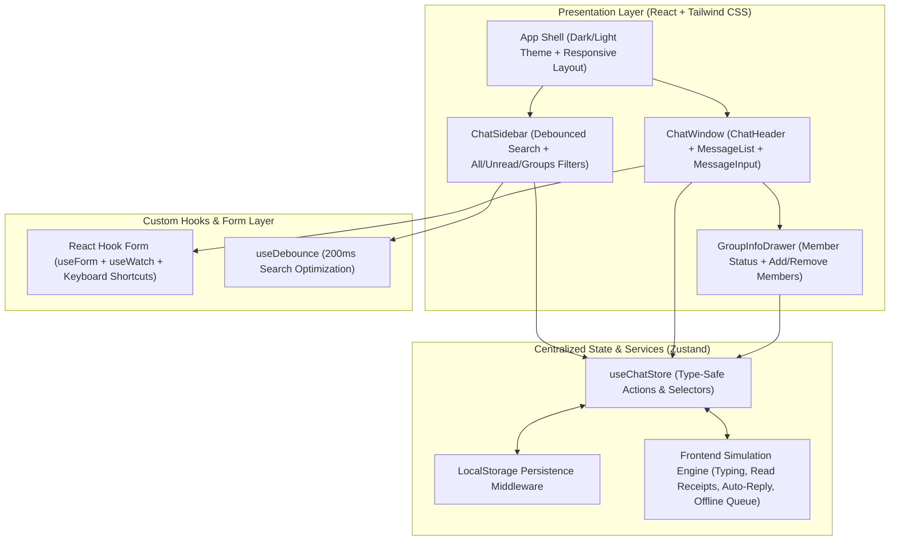

# PulseChat — Modern Real-Time Messaging Architecture

🚀 **Live Production Demo:** [https://pulse-chat-dun-alpha.vercel.app](https://pulse-chat-dun-alpha.vercel.app)  
📦 **GitHub Repository:** [https://github.com/RohitKohat/pulse-chat](https://github.com/RohitKohat/pulse-chat)

A modern, responsive chat application inspired by Slack and WhatsApp Web, engineered for the **Senior Frontend Developer Take-Home Assignment**.

---

## ✨ Implemented Features

### Core Functional Requirements
- **Chat Sidebar**: Conversation list, profile avatars with live status indicators (`online`, `away`, `offline`), last message preview + formatted timestamp, unread count badges, **debounced conversation search**, and filter tabs (**All**, **Unread**, **Groups**).
- **Chat Window**: Grouped messages by date (`Today`, `Yesterday`, full date), delivery & read indicators (`sending` → `sent` → `delivered` → `read`), contextual message replies, auto-scroll to latest message, and animated typing indicators.
- **Message Interactions**: Edit sent messages (`(edited)` badge), soft-delete messages, reply with quote preview, 1-click copy to clipboard with toast notification, and 6-emoji reaction picker with live counters.
- **Group Conversations**: Slide-over Group Info drawer displaying group description, member count, member roles/online status, and interactive mock **Add / Remove Member** controls.
- **User Experience**: Responsive Desktop/Tablet split-view and Mobile single-pane navigation, Dark & Light theme toggle persisted in `localStorage`, in-chat message search bar, and keyboard shortcuts (`Enter` to send, `Shift + Enter` for newline).

### Bonus / Advanced Challenges Included
- **Optimistic Message Sending** with automated `sent` → `delivered` → `read` status progression and simulated teammate typing + replies.
- **Offline Message Queue Simulation**: Toggle the Wi-Fi icon in the header to queue messages while offline (`queued` clock icon) and watch them auto-flush when reconnected.
- **LocalStorage Persistence**: Powered by Zustand `persist` middleware so messages, edits, reactions, and theme state survive browser refreshes.
- **Local Attachment Preview**: Attach images or files from your device with instant preview before and after sending.
- **HR / Reviewer Demo Toolbar**: Built-in `+ Incoming Msg` trigger and `Reset Demo Data` button for effortless evaluation.

---

## 🛠️ Tech Stack

| Category | Technology |
| :--- | :--- |
| **Framework** | React 18 + Vite |
| **Language** | TypeScript (Strict Mode) |
| **Styling** | Tailwind CSS (Dark & Light Mode) |
| **State Management** | Zustand (with `persist` LocalStorage middleware) |
| **Forms** | React Hook Form |
| **Icons** | Lucide React |
| **Testing** | Vitest + React Testing Library + JSDOM |

---

## 🚀 Installation & Setup Instructions

```bash
# 1. Clone the repository
git clone https://github.com/RohitKohat/pulse-chat.git
cd pulse-chat

# 2. Install dependencies
npm install

# 3. Start the development server (http://localhost:5173)
npm run dev

# 4. Run unit & interaction tests
npx vitest run

# 5. Build for production
npm run build
```

---

## 🏗️ Architecture Diagram



---

## 🧠 State Management & Key Architectural Decisions

1. **Feature-Based Folder Structure (`src/features/{conversations,chat,groups}`)**:
   Separates domain-specific views from reusable atomic UI (`src/components/ui`), centralized state (`src/store`), mock data (`src/services`), and pure utilities (`src/utils`).
2. **Zustand over Redux Toolkit**:
   Provides a clean, minimal-boilerplate store with built-in `persist` middleware for `localStorage` synchronization and straightforward testing outside React components.
3. **Frontend Real-Time Simulation & Trade-offs**:
   Per the specification (*"Backend is not required"*), real-time events (receipts, typing indicators, auto-replies, and offline queue flushing) are simulated deterministically in the store layer so the UI can be evaluated standalone with zero external backend dependencies.